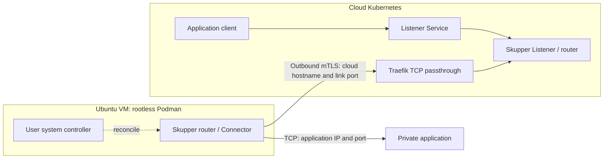
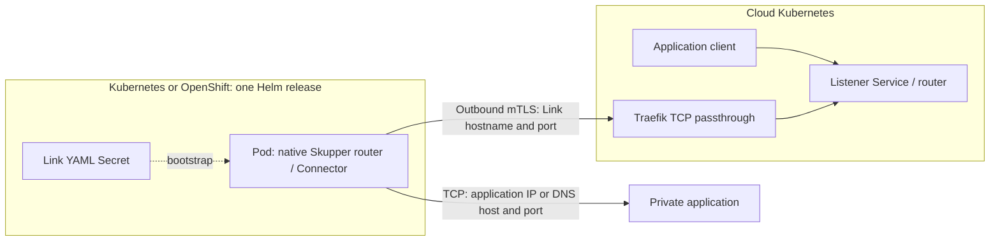

# SaaS Connector architecture

Applications in the cloud use an ordinary namespace-local TCP Service. A Skupper
Listener forwards its connections through a mutually authenticated TLS link to
the Connector that can reach the application. Listener and Connector must share
the same routing key. Different keys isolate application routes, while network
policy and Kubernetes permissions control access to each Listener Service.

## Ubuntu connector

The connection between sites is initiated from the VM. No inbound VM firewall
port is required by this setup. Application requests and responses travel over
the established link. Traefik routes by TLS SNI and passes TLS through to Skupper;
it must not replace the router certificate or terminate this connection.

The VM controller and router use host networking. The cloud hostname comes from
the Link bundle and uses normal name resolution by default. An optional cloud IP
override creates a VM hosts-file mapping, configured before creating the router. The
rootless account owns the CLI, containers, configuration, and private credentials.
Lingering and enabled user services allow operation without an interactive login.

## Kubernetes connector

The connector extends the official Skupper router 3.5.3 image with CLI 2.2.3. Its
Bash entrypoint renders Linux-platform configuration and executes `skrouterd`
directly. No Podman, Docker daemon, systemd, Skupper operator, or CRDs are needed
inside the target cluster. Each Helm release owns its Deployment, Secret, and
disposable generated state; one release exposes one application.

Without an override, the router uses cluster DNS. With `cloudIp`, the chart uses
pod `hostAliases` for the hostname inferred from the Link YAML. The Link's endpoint
and TLS identity stay intact. The pod runs as an arbitrary non-root UID with a
read-only root filesystem and writable `emptyDir` volumes. No host mounts or
cluster API permissions are required. Existing cloud sites and Traefik remain
administrator-managed.

## Boundaries and operations

- **Credentials:** each remote site gets its own client certificate/Secret bundle.
  Possession grants access to the Skupper network; transfer it securely and never
  publish it. Use separate routing keys where cross-target load balancing is unwanted.
- **Encryption:** mTLS protects the inter-site hop. Router-to-application and
  client-to-Listener encryption depend on the application's protocol and TLS setup.
- **Exposure:** only router access is exposed through Traefik. Listener Services
  remain internal to Kubernetes; namespace membership alone is not a network boundary.
- **Availability:** one router and one VM or pod are single failure points.
  Kubernetes upgrades use Recreate and interrupt active connections briefly.
  Reconnection is supported; HA is outside this implementation.
- **Validation:** configured resources, operational link, matching routing key,
  reachable TCP target, and correct application response are distinct checks.
  Only the final application request proves the complete intended behavior.
- **Changes:** target updates reconcile in place. Router/proxy replacement may
  interrupt active connections. Version upgrades and credential revocation require
  planned operations and live acceptance tests.

See [README.md](README.md) for VM operation, [container/README.md](container/README.md)
for Helm deployments, and [tests/acceptance.md](tests/acceptance.md) for live checks.
