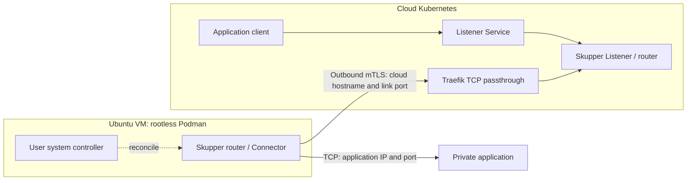
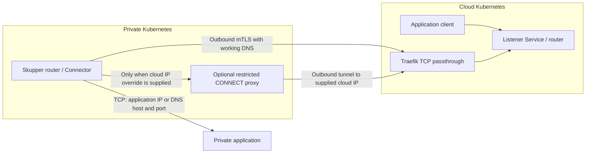

# Architecture

Applications in the cloud use an ordinary namespace-local TCP Service. A Skupper
Listener forwards its connections through a mutually authenticated TLS link to
the Connector that can reach the application. Listener and Connector must share
the same routing key. Different keys isolate application routes, while network
policy and Kubernetes permissions control access to each Listener Service.

## Ubuntu connector

The connection between sites is initiated from the VM. No inbound VM firewall
port is required by this setup. Application requests and responses travel over
the established link. Traefik routes by TLS SNI and passes TLS through to Skupper;
it must not replace the router certificate or terminate this connection.

The VM controller and router use host networking. The cloud hostname is mapped
to the supplied IP in the VM hosts file and verified inside the router. The
rootless account owns the CLI, containers, configuration, and private credentials.
Lingering and enabled user services allow operation without an interactive login.

## Kubernetes connector

Without an override, the router uses cluster DNS. With an override, the installer
owns a separate proxy Deployment whose hosts entry maps the cloud hostname to
the supplied IP. Skupper uses its supported CONNECT proxy setting. The proxy
permits only that hostname/port; mTLS and SNI remain end-to-end. It does not
intercept TLS, change cluster DNS, or patch Skupper-generated Deployments.

The cloud listener and Kubernetes connector scripts are delivered independently
against the Ubuntu branch. Each requires an explicit kube context and namespace.
Existing clusters and Traefik remain administrator-managed. Installing a namespace
controller is an explicit action; CRD/controller upgrades are separate work.

## Boundaries and operations

- **Credentials:** each remote site gets its own client certificate/Secret bundle.
  Possession grants access to the Skupper network; transfer it securely and never
  publish it. Use separate routing keys where cross-target load balancing is unwanted.
- **Encryption:** mTLS protects the inter-site hop. Router-to-application and
  client-to-Listener encryption depend on the application's protocol and TLS setup.
- **Exposure:** only router access is exposed through Traefik. Listener Services
  remain internal to Kubernetes; namespace membership alone is not a network boundary.
- **Availability:** one router and one VM/proxy instance are single failure points.
  Reconnection and reboot recovery are supported; HA is outside this implementation.
- **Validation:** configured resources, operational link, matching routing key,
  reachable TCP target, and correct application response are distinct checks.
  Only the final application request proves the complete intended behavior.
- **Changes:** target updates reconcile in place. Router/proxy replacement may
  interrupt active connections. Version upgrades and credential revocation require
  planned operations and live acceptance tests.

See [README.md](README.md) for VM operation and [tests/acceptance.md](tests/acceptance.md)
for the validation matrix. Kubernetes-specific instructions accompany their scripts.
