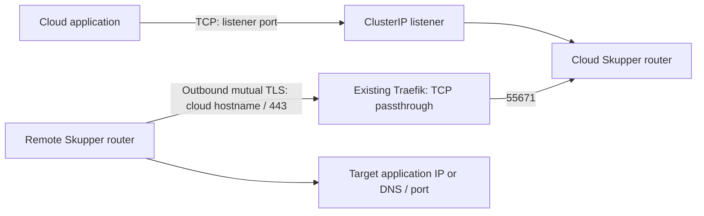

# Cloud Kubernetes listener

`setup-skupper-cloud-listener.sh` creates the cloud side of a Skupper **2.2.3** application network. It uses one router and an existing Traefik deployment, and exports a private Link + Secret bundle for one Ubuntu VM or remote Kubernetes site.



The remote site initiates the connection. Application traffic flows both ways over that connection. Traefik passes TLS through to Skupper; Skupper certificates authenticate both routers. Backend application encryption remains the application's responsibility.

## Prerequisites

Run on an administrator workstation with Bash, Python 3 + PyYAML, `kubectl`, and the Skupper CLI **2.2.3**. Helm **3** is required only with `--install-controller`. On Ubuntu, PyYAML is available as `python3-yaml`. The script installs no workstation dependencies.

The Kubernetes cluster and namespace must already exist. Existing Traefik must watch the namespace and its `traefik.io/v1alpha1` TCP resources, expose the selected entrypoint publicly, and permit TCP passthrough. Configure the hostname's DNS (or the remote installer's hostname/IP override), public address and firewall separately. Do not put an HTTP proxy or TLS-terminating ingress in this connection path. Cloudflare DNS records, if used, must be DNS-only.

The installer checks create/patch permission for its custom resources before making changes. The operator needs cluster-wide read access to Deployments, Skupper CRDs and Traefik TCP routes to detect controller and hostname conflicts; namespace access to Site, Certificate, RouterAccess, Listener, Secret, ConfigMap and Service resources; and permission to apply the installer-owned resources. Explicit controller installation additionally requires Helm's namespace resources and cluster-wide CRD creation rights. Admission policies, registry access and resource quotas must allow the upstream Skupper workloads.

The script reuses exactly one compatible controller that actually covers the namespace. It checks `WATCH_NAMESPACE`/controller arguments and the namespace's `ConfigMap/skupper` assignment. Unclear scope, an overlapping controller, an incompatible controller image, or incompatible v2alpha1 CRDs produces an error. Existing controllers and CRDs are **never upgraded**. Install or upgrade shared CRDs separately through your cluster administration process.

## Run

Download the script from a reviewed repository revision, then run it with your values:

```bash
bash setup-skupper-cloud-listener.sh \
  --context production-cloud \
  --namespace customer-network \
  --listener-name application \
  --listener-port 7990 \
  --routing-key customer-application \
  --cloud-host skupper.example.com \
  --client-id customer-vm-01 \
  --link-output "$HOME/customer-vm-01-link.yaml"
```

Add `--install-controller` to install a namespace-scoped 2.2.3 controller when none covers the namespace. This is a new installation only; the flag does not authorize replacing another controller. Do not run multiple installers concurrently against one namespace.

| Optional argument | Default |
| --- | --- |
| `--site-name` | Namespace |
| `--cloud-port` | `443` |
| `--entrypoint` | `websecure` |
| `--ingress-class` | No explicit class; existing Traefik must accept unclassified resources |
| `--timeout` | `180` seconds per readiness check |

Namespace, listener name and routing key must be lowercase DNS labels of at most 63 characters; the site name is limited to 58 and client ID to 56 so derived resource names fit Kubernetes limits. Use a distinct `--client-id` and output file for every remote site. Use distinct routing keys for unrelated customer backends; connectors sharing a routing key may receive traffic for the same listener. The listener port and backend target port can differ. The generated bundle already advertises the supplied public hostname and port; no manual YAML edits are necessary.

The script creates a Site, server Certificate, local RouterAccess, Traefik TCP route, Listener and client Certificate. Existing objects with these names must carry this installer's ownership annotation; it refuses automatic adoption. Use a dedicated namespace or explicitly review migration of an older manual installation before running it. The fixed ingress resource names are `skupper`, `skupper-traefik`, and `skupper-traefik-server`.

## Credentials, reruns and updates

The output file is created atomically with permissions `0600`. Transfer it securely to the remote site, use it with the VM or Kubernetes connector installer, and remove transfer copies when no longer needed. Never commit the file, send it to logs or publish it as a CI artifact. It contains a private key.

A rerun with the same client ID reuses that site's Certificate. It accepts an existing output only when it is owned by the current user, has mode `0600`, and matches the generated bundle. It refuses silent credential replacement and changes to the ingress class, public hostname or router access configuration. Choose a new client ID for a new remote site; changing an existing site's credentials is an explicit migration requiring changes on both sides. Skupper client certificates are long-lived credentials, not expiring single-use enrollment tokens. Deleting the exported file or its source Secret does not revoke previously exported credentials; use Skupper's documented CA/certificate rotation procedures for compromise recovery.

On failure, already-created resources remain for diagnosis and rerun. The script does not delete other objects or perform rollback of application configuration. Helm uses `--atomic` for a newly installed controller. Each check and command has a timeout; errors name the failed resource or operation without dumping secret output.

## Verify and operate

The installer checks controller coverage and rollout, required CRD fields, Site readiness and controller version, Certificate/RouterAccess readiness, and Listener **Configured**. A matching connector is intentionally unnecessary during cloud bootstrap. A successful cloud installation does not prove that external DNS, Traefik, firewalls, the remote network, or the backend are reachable.

After installing the remote connector, run these from the administrator workstation:

```bash
kubectl --context production-cloud -n customer-network get sites,routeraccesses,listeners
skupper --platform kubernetes --context production-cloud -n customer-network listener status
```

From an existing application pod, connect to `application:7990` using the application's normal client and confirm its expected response. For HTTP, a `curl --max-time 15 http://application:7990/` check is suitable. Do not apply HTTP tests to arbitrary TCP services. Monitor the router Deployment, Skupper resource conditions, certificate expiry, and the application's own health through your existing monitoring system. A configured listener alone is not an application health check.

For problems, inspect resource conditions, namespace events and controller/router logs. Check the remote site's Link status and its target application's reachability. Hostname SNI, certificate identity, port forwarding and ingress-class selection must agree. Avoid logging Secret contents.

## Validation

```bash
bash -n skupper/setup-skupper-cloud-listener.sh
shellcheck skupper/setup-skupper-cloud-listener.sh
python3 -m unittest discover -s skupper/tests -p test_cloud_listener.py -v
```

Hermetic tests cover private credential export and repeat runs, input rejection, incompatible versions/CRDs, controller assignment, unmanaged resource collisions, credential conflicts, ingress-class changes, symlinks and stale readiness generations. They use simulated API responses and make no network or cluster changes.

Before production rollout, validate on a disposable cluster with the installed Traefik version: explicit fresh controller installation; reuse of namespace and cluster controllers; two runs with the same inputs; a remote VM and Kubernetes connector; backend response through the listener; and remote/network failure recovery. These live scenarios have **not** been run by this change. The installer does not assume access to customer clusters.

Upstream references: [Skupper 2.2.3 chart](https://github.com/skupperproject/skupper/blob/2.2.3/charts/skupper/README.md), [link generation](https://github.com/skupperproject/skupper/blob/2.2.3/internal/cmd/skupper/link/kube/link_generate.go), [local RouterAccess](https://github.com/skupperproject/skupper/blob/2.2.3/internal/kube/securedaccess/local.go), [Traefik TCP routing](https://doc.traefik.io/traefik/reference/routing-configuration/kubernetes/crd/tcp/ingressroutetcp/).
